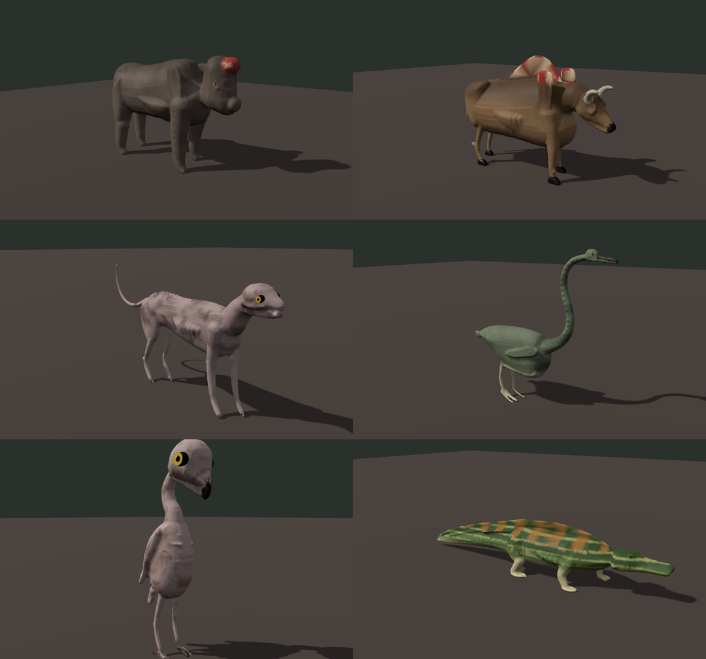
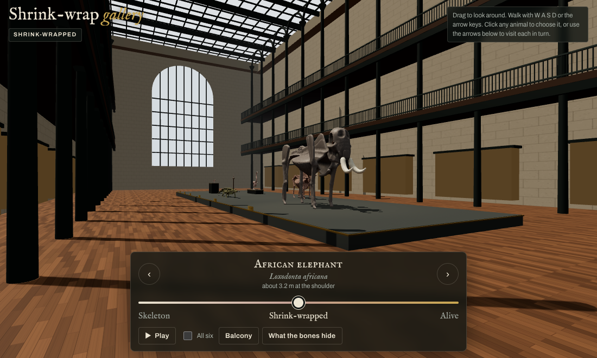
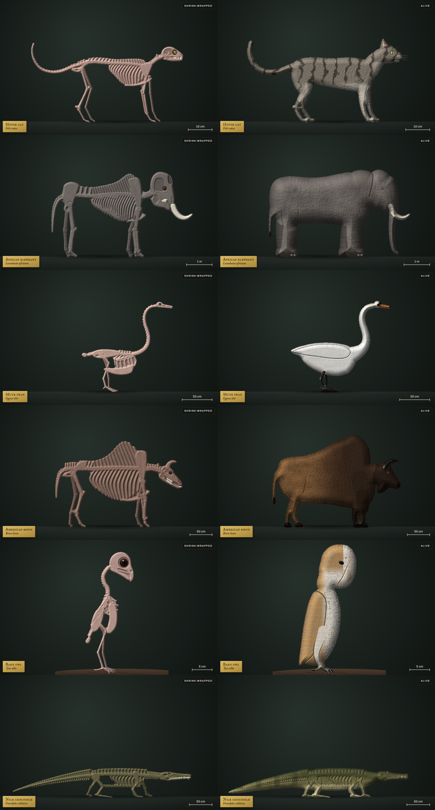

# Wrapper: the Shrink-Wrap Gallery

A walkable 3D hall modelled on the Grande Galerie de l'Évolution in Paris. Six living animals march in a procession down the nave at real scale: an African elephant, an American bison, a Nile crocodile, a mute swan, a house cat and a barn owl. Each one slides through four stages: **skeleton** → **shrink-wrapped** → **the curator's model** → **alive**.

The curator's model follows the closing section of *All Yesterdays*, where living animals are restored by people who have only ever seen their bones. The gallery speaks in the curator's voice until the reveal:

| Bones of… | Curator's restoration | The misreading |
|---|---|---|
| African elephant | *Nasocrista ingens*, the great crest-nose | The forehead nasal opening becomes an inflatable display hood; no trunk, no ears, tiptoe feet |
| American bison | *Velifer pratensis*, the sail-backed grazer | Tall shoulder spines become a striped Dimetrodon-style sail |
| Nile crocodile | *Labiosuchus fluvialis*, the lipped river-hunter | Lizard-style lips over the teeth, and a crest along the back plates |
| Mute swan | *Ophidornis squamatus*, the scaly snake-bird | A scaly, slender-necked wader with a paddle for a wing and unwebbed toes |
| House cat | *Nudodon parvus*, the little bare-tooth | Hairless and lipless, with bare fangs and no ears or whiskers |
| Barn owl | *Oculator gracilis*, the slender eye-bearer | A bald, gangly stalker with huge staring eyes and bare legs |



In 3D the skin grows out of the bones, swells into the curator's guess, and then reshapes into the real animal.



## Visiting

Open `index.html` from a static server (for example `python3 -m http.server`) or GitHub Pages. There is no build step.

- **Look:** drag. **Walk:** W A S D or the arrow keys (Shift to hurry); on a phone, use the joystick.
- **Choose an animal:** look at it, tap it, or use ‹ › to glide to each one.
- **Balcony:** go up to the first gallery and look down on the procession.
- **All six:** move every animal through the stages together.

`plates/` holds the earlier flat side-view version.



## How it's made

- `js/anatomy.js`: each animal as simplified anatomy. Bones, teeth, holes, recesses and soft tissue are authored in side-view coordinates with lateral depth: ribs hoop around the chest, skulls are inflated with widths that taper along the snout, and limbs and girdles sit on each side.
- `tools/export3d.js`: runs the anatomy through a 3D builder and writes primitives to `build/prims/`.
- `tools/bake.py`: voxelises each animal (numpy, scipy, scikit-image, fast-simplification) and builds three surfaces:
  - **bone**
  - **shrink-wrap**: a morphological closing of the bones, so skin can't squeeze between ribs but sinks into every hollow, plus a skin thickness, with teeth kept sharp
  - **alive**: wrap plus soft tissue, closed and smoothed, with fur displacement

  - **curator**: wrap plus the curator's soft tissue (layer `ctissue` in the anatomy), with its own colours and eyes

  Every wrap vertex is projected onto the bones, every curator vertex onto the wrap, and every living vertex onto the curator's model. Those projections are the morph targets that let the skin grow in real time. Output goes to `data/<id>.json`, with mesh arrays packed as base64.
- `js/specimen.js`: loads a baked animal into three morphing meshes, with coat colours computed from the anatomy file.
- `js/hall.js` and `js/main.js`: the hall (glass roof, cast-iron columns, two balcony tiers, procession platform), navigation and the UI.

To rebuild the meshes:

```
node tools/export3d.js
python3 tools/bake.py            # or: python3 tools/bake.py cat owl
```

The skeletons are diagrams, not traced specimens. The idea comes from *All Yesterdays* (2012) by John Conway, C. M. Kosemen and Darren Naish.
